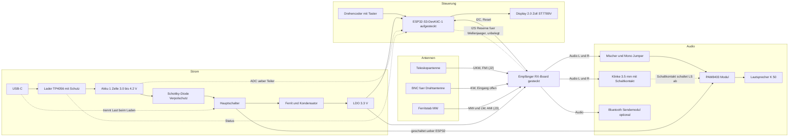

# Funkfüürli: Blockschaltbild (Stand 2026-11-19, Entwurf)

Grober Aufbau. Der Empfänger ist im Repo [RX-Board-Si4732](https://github.com/MaShaoDe/RX-Board-Si4732) beschrieben (Verdrahtung im Gerät: [rx-board.md](rx-board.md)). Die Pins stehen in [pinplan.md](pinplan.md), die Gründe in [konzept.md](konzept.md). Die Basisplatine entsteht im Repo [Funkbasis-ESP32](https://github.com/MaShaoDe/Funkbasis-ESP32). Auf dem RX-Board Rev A liegt UKW am Eingang FMI (J2), MW und LW am Eingang AMI (J3). Der KW-Eingang ist offen und wird mit Rev A getestet.

## Gesamt

## Hinweise

* Ein Schaltregler kommt nicht ins Gerät. Der PAM8403 schaltet selbst und wird im Prototyp gemessen (siehe Anforderungen).
* Der Ferritstab sitzt am Gehäuserand, weit weg von Akku, Lautsprecher, ESP32, Display und Lader.
* Die Verstärker-Versorgung wird über den ESP32 geschaltet (GPIO 5), weil das Modul vermutlich keinen Standby-Pin hat.
* Laden und Hören gehen nicht gleichzeitig. Die USB-Erkennung trennt die Last.
* Stecker RX zum Funkmodul: Rev A hat 1x9 (Ton L und R, GND, 3V3, SDA, SCL, RST, INT, GND), Rev B bekommt 1x13 mit 4 Reservepins für I2S.
* KW: Ob der Eingang FMI oder AMI heissen muss, entscheidet der Rev-A-Test (Pflichtenheft RX-Board, Abschnitt 3). Mit Rev B kommen dann KW-Zweig und Umschaltung.

*Copyright FerienBSD aka Marcel Sauder. Doku unter CC-BY-4.0.*
