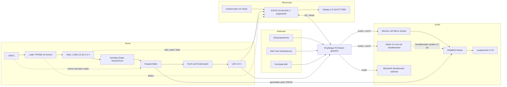

# Funkfüürli: Blockschaltbild (Stand 2026-11-15, Entwurf)

Grober Aufbau. Der Empfänger ist in [rx-board.md](rx-board.md) beschrieben. Die Pins stehen in [pinplan.md](pinplan.md), die Gründe in [konzept.md](konzept.md). Die Anschlüsse am Si4732 (welche Antenne an welchen Eingang) sind noch zu klären und hier bewusst offen.

## Gesamt

## Hinweise

* Ein Schaltregler kommt nicht ins Gerät. Der PAM8403 schaltet selbst und wird im Prototyp gemessen (siehe Anforderungen).
* Der Ferritstab sitzt am Gehäuserand, weit weg von Akku, Lautsprecher, ESP32, Display und Lader.
* Die Verstärker-Versorgung wird über den ESP32 geschaltet (GPIO 5), weil das Modul vermutlich keinen Standby-Pin hat.
* Laden und Hören gehen nicht gleichzeitig. Die USB-Erkennung trennt die Last.

*Copyright FerienBSD aka Marcel Sauder. Doku unter CC-BY-4.0.*
